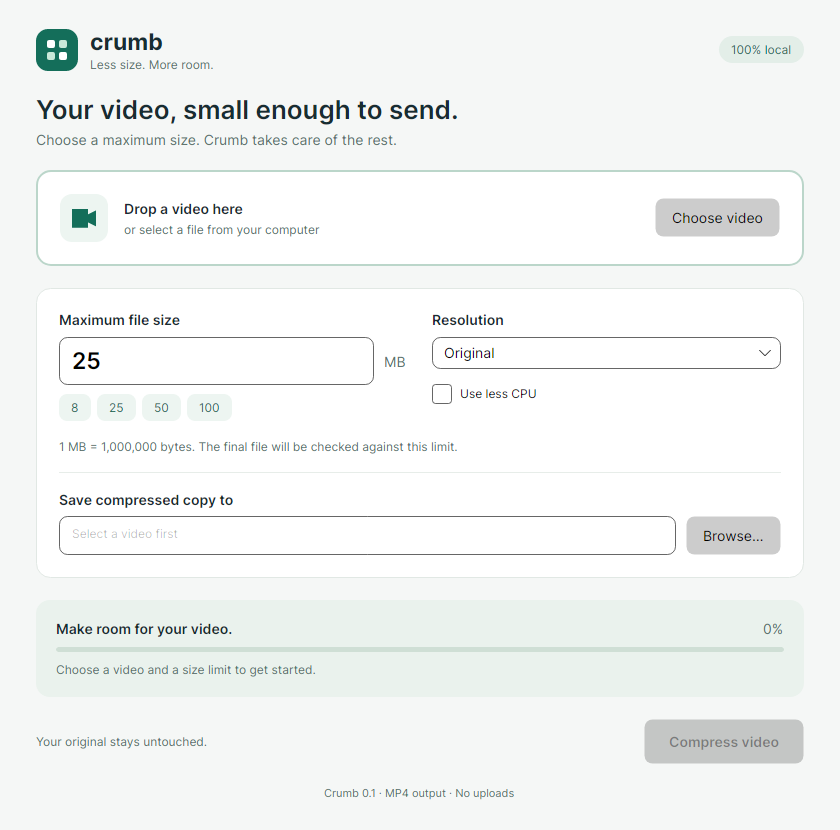

# Crumb

A lightweight desktop video compressor. Choose a video, set a maximum file size, and save an MP4 copy ready to share.



## Features

- Choose a video or drag it onto the window.
- Set any limit from 0.1 MB to 1,000,000 MB, with quick presets.
- Keep the original resolution or reduce it to 1080p, 720p, or 480p.
- See progress and cancel a job without leaving a partial final file.
- Check the actual output size and duration before reporting success.
- Compress locally, preserve the original, and optionally use fewer CPU threads.

Crumb targets the maximum size; it does not promise to fill every available byte or preserve the original quality. Small limits can produce noticeable quality loss. If a video already fits, Crumb offers to open the original instead of re-encoding it.

## Download and use

Windows x64 preview builds are produced by [GitHub Actions](https://github.com/Hardnyx/crumb-video/actions/workflows/build.yml). Successful builds from `main` are published as [prereleases](https://github.com/Hardnyx/crumb-video/releases).

Download `Crumb-0.1.0-win-x64.zip`, extract the complete folder, and run `Crumb.exe`. FFmpeg and ffprobe are included, so no separate .NET, Python, or FFmpeg installation is required. An optional per-user installer uses the same application files.

These are early preview builds. The interface is tested with Avalonia's headless platform; native file dialogs and behavior on a clean Windows installation still need manual verification. See the [usage guide](docs/usage.md) for behavior and limits.

## Development

The application uses **C# / .NET 10**, **Avalonia 12.1.4**, and separate FFmpeg/ffprobe processes. Windows releases use Native AOT; a self-contained fallback can be built explicitly. The UI and compression core are separate projects.

Install the .NET 10 SDK and obtain FFmpeg with libx264 and AAC support. Set `CRUMB_FFMPEG_DIR` to the folder containing ffmpeg and ffprobe:

```powershell
$env:CRUMB_FFMPEG_DIR = 'C:\tools\ffmpeg\bin'
dotnet build Crumb.sln -c Release
dotnet test tests/Crumb.Tests -c Release
dotnet run --project src/Crumb.Desktop
```

On Linux, for example, use `export CRUMB_FFMPEG_DIR=/usr/bin`. The core and headless tests run on Linux; native Linux and macOS distribution support is not established yet.

The Windows workflow builds its media tools from pinned, hash-checked FFmpeg and x264 sources, tests the bundle, publishes the app, and compresses a real clip through the resulting executable before packaging it. See [building releases](docs/building.md).

## Project documents

- [Usage](docs/usage.md)
- [Architecture and size policy](docs/architecture.md)
- [Building portable releases and installers](docs/building.md)
- [Roadmap](docs/roadmap.md)
- [Contributing](CONTRIBUTING.md)
- [Third-party components](docs/third-party.md)

## License

Crumb's original code and documentation are [MIT licensed](LICENSE). The bundled FFmpeg/x264 tools have their own GPL licenses. Their corresponding source archives, build script, and notices accompany the portable distribution.
